# Fleet Intelligence — Sem Parar Empresas

## 1. Sobre o projeto

O **Fleet Intelligence** é uma solução acadêmica desenvolvida para o Enterprise Challenge da FIAP, com foco no apoio à gestão de frotas.

O objetivo é transformar dados operacionais e financeiros em informações que auxiliem o gestor de frota a acompanhar indicadores, identificar veículos que necessitam de atenção e avaliar oportunidades de melhoria.

O projeto utiliza dados sintéticos, telemetria simulada com ESP32 no Wokwi, processamento em Python, análise estatística, regras de diagnóstico e um modelo introdutório de Machine Learning.

## 2. Escopo

O desenvolvimento considera as necessidades do perfil **Gestor de Frota**.

Principais funcionalidades:

- Integração e validação de dados da frota.
- Benchmark de custos e eficiência por categoria de veículo.
- Monitoramento de telemetria simulada.
- Identificação de alertas e anomalias.
- Diagnóstico de eficiência por regras.
- Classificação experimental utilizando Machine Learning.
- Visualização dos indicadores em uma aplicação Streamlit.

## 3. Planejamento das Sprints

| Sprint | Objetivo |
|---|---|
| Sprint 1 | Planejamento e definição da solução |
| Sprint 2 | Inteligência e diagnóstico |
| Sprint 3 | Estimativa de economia e recomendações |
| Sprint 4 | Integração, interface e finalização |

---

# 4. Sprint 1 — Planejamento e definição

A primeira Sprint foi dedicada à definição do problema, levantamento dos requisitos, organização das histórias de usuário e planejamento da arquitetura da solução.

Também foi estruturada a base de dados sintética utilizada no desenvolvimento.

**Principais entregas:**

- Definição do escopo voltado ao Gestor de Frota.
- Levantamento das histórias de usuário.
- Planejamento da arquitetura.
- Estruturação do dataset inicial.
- Organização do backlog das quatro Sprints.

### Arquitetura da solução

<!-- INSERIR DIAGRAMA DA ARQUITETURA AQUI -->

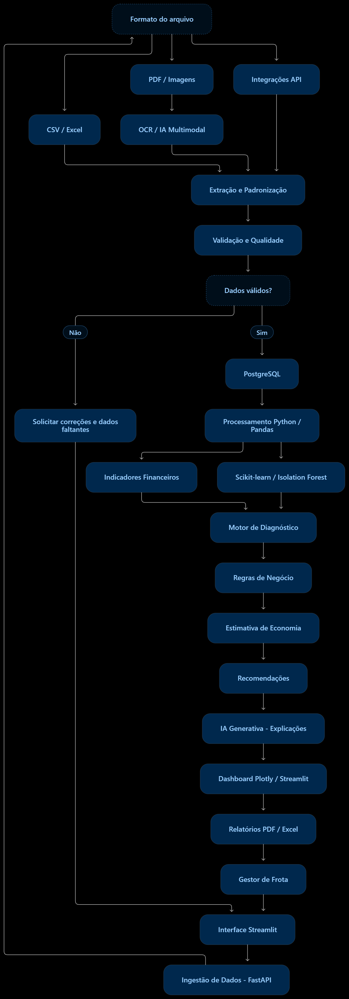

---

# 5. Sprint 2 — Inteligência e diagnóstico

A segunda Sprint concentrou-se na implementação do processamento de dados, análise da frota, monitoramento de telemetria e diagnóstico de eficiência.

## 5.1. Integração e qualidade dos dados

Foi desenvolvido um processo de integração utilizando Python e Pandas.

O processo reúne informações de despesas, cadastro de veículos e telemetria, utilizando o identificador do veículo como referência.

**Resultados da integração:**

- 194 registros de despesas.
- 12 veículos cadastrados.
- 194 registros integrados.
- 194 registros classificados como OK.
- Nenhum registro encaminhado para revisão na execução validada.

Foram implementadas verificações de qualidade, incluindo identificação de valores negativos, campos obrigatórios ausentes, duplicidades, veículos desconhecidos e inconsistências.

## 5.2. Simulação de telemetria com ESP32

Foi desenvolvido um protótipo de telemetria utilizando ESP32 no ambiente Wokwi.

A simulação considera as seguintes variáveis:

- Velocidade.
- Rotação do motor (RPM).
- Nível de combustível.
- Temperatura do motor.

O sistema identifica condições de alerta e utiliza LED, buzzer e mensagens no Serial Monitor para representar as ocorrências.

A telemetria foi exportada para CSV e processada posteriormente em Python.

**Importante:** os dados de telemetria são simulados e não representam medições reais de um veículo.

<!-- INSERIR LINK DO PROJETO WOKWI AQUI -->

## 5.3. Benchmark da frota

Foi desenvolvido um processo de análise comparativa dos veículos, considerando:

- Custo por quilômetro.
- Eficiência de combustível em km/L.
- Custos por categoria.
- Média, mediana e quartis.
- Ranking de eficiência.

O benchmark foi agrupado por tipo de veículo, evitando comparações diretas entre categorias com características operacionais diferentes.

### Resultados visuais

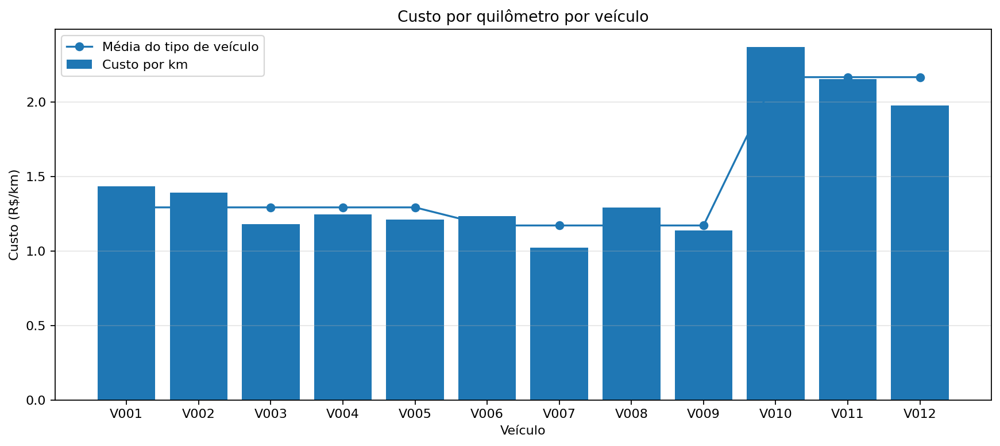

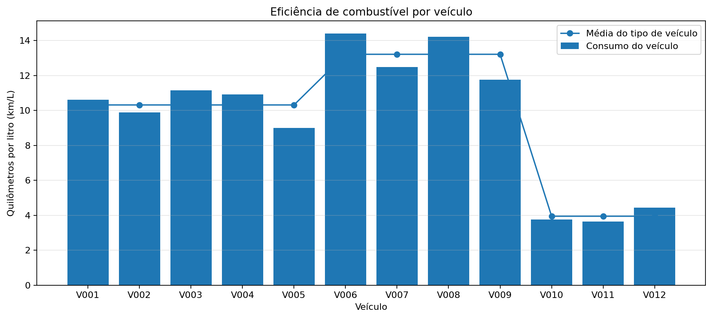

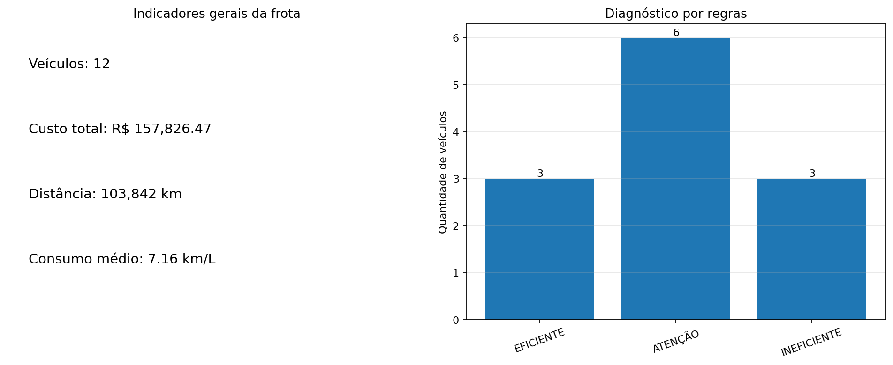

## 5.4. Diagnóstico por regras

Foi implementado um mecanismo de diagnóstico baseado em critérios operacionais e financeiros.

Os veículos são classificados em três categorias:

- **EFICIENTE:** nenhum dos critérios definidos foi acionado.
- **ATENÇÃO:** um critério foi acionado.
- **INEFICIENTE:** dois ou mais critérios foram acionados.

Os critérios consideram o custo por quilômetro, a eficiência de combustível e, quando disponível, o diagnóstico da telemetria.

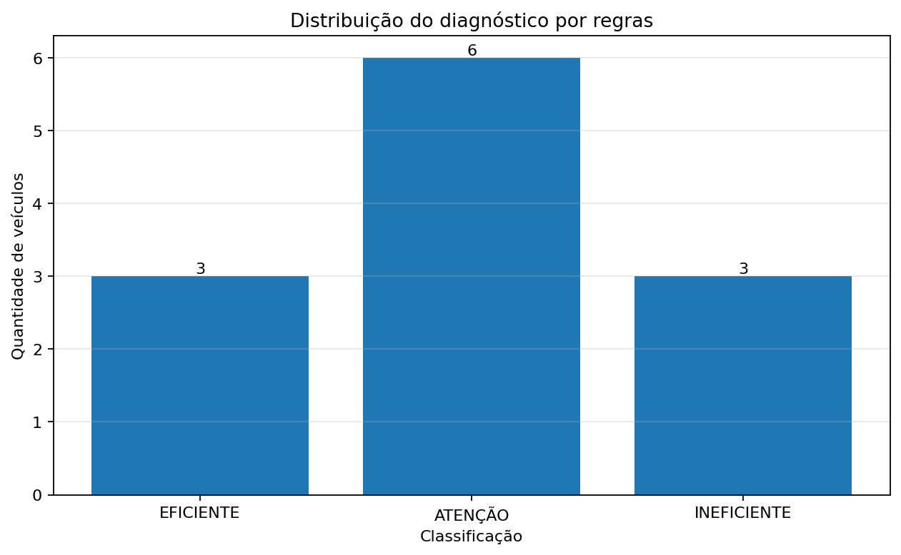

## 5.5. Análise de telemetria

A telemetria simulada foi analisada para identificar leituras com alertas e acompanhar as variáveis monitoradas.

Na simulação utilizada, foram registrados:

- 17 registros de telemetria.
- 5 leituras com alertas.
- Taxa de leituras com alerta de 29,41%.
- Ocorrências de temperatura elevada e RPM elevado.

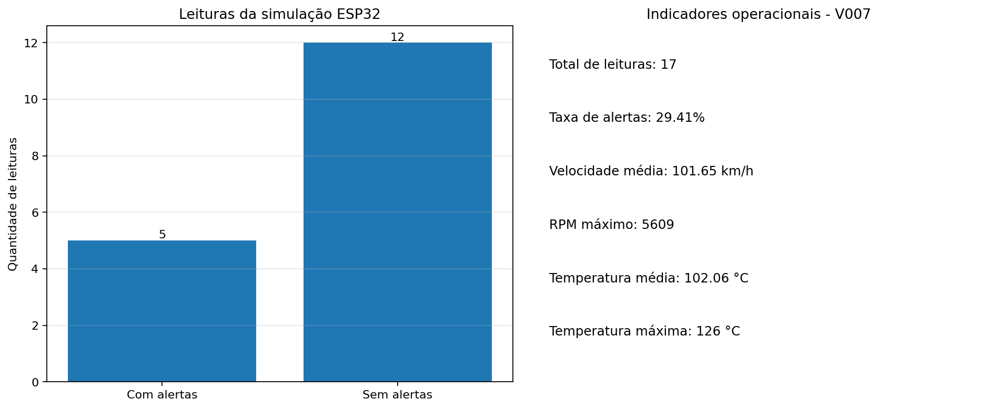

## 5.6. Classificação com Machine Learning

Foi desenvolvido um classificador introdutório utilizando **Decision Tree**, por meio da biblioteca Scikit-learn.

O modelo utiliza indicadores derivados do benchmark e o nível de diagnóstico da telemetria como variáveis de entrada.

A base foi dividida em treinamento e teste:

- Treinamento: 8 registros.
- Teste: 4 registros.
- Acurácia: 25%.
- Acurácia balanceada: 33,33%.

### Matriz de confusão

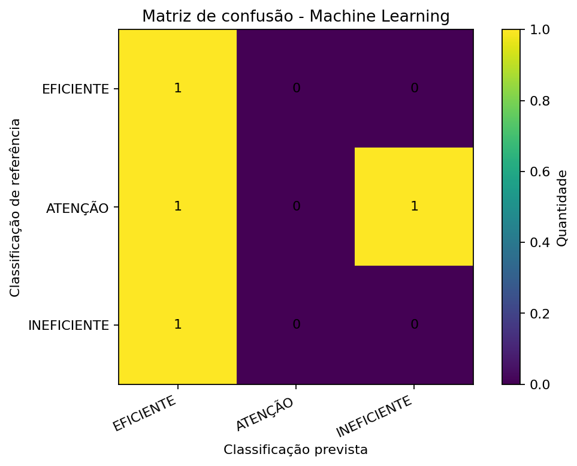

### Comparação entre regras e Machine Learning

O resultado do modelo foi comparado com o diagnóstico baseado em regras.

Na amostra de teste, houve concordância em 1 dos 4 veículos avaliados, equivalente a 25%.


**Limitações:** a base utilizada é pequena e sintética. Além disso, as classes utilizadas no treinamento foram derivadas das próprias regras de diagnóstico. Portanto, o modelo tem caráter experimental e não deve ser considerado um classificador validado para uso operacional. Nesta etapa, as regras permanecem como referência principal do diagnóstico.

---

# 6. Aplicação Streamlit

Foi desenvolvida uma interface utilizando Streamlit para reunir os resultados e permitir a navegação entre as principais funcionalidades do protótipo.

A aplicação está organizada em quatro telas:

## 6.1. Página inicial — Visão geral

Apresenta os principais indicadores consolidados da frota, incluindo quantidade de veículos, custos, distância percorrida, eficiência média e distribuição dos diagnósticos.

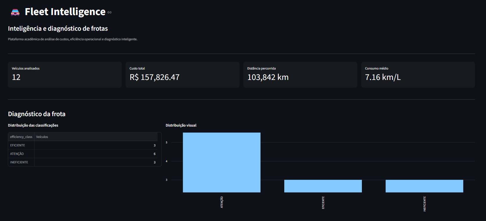

## 6.2. Benchmark da frota

Apresenta os indicadores comparativos por tipo de veículo, estatísticas do benchmark e ranking individual.

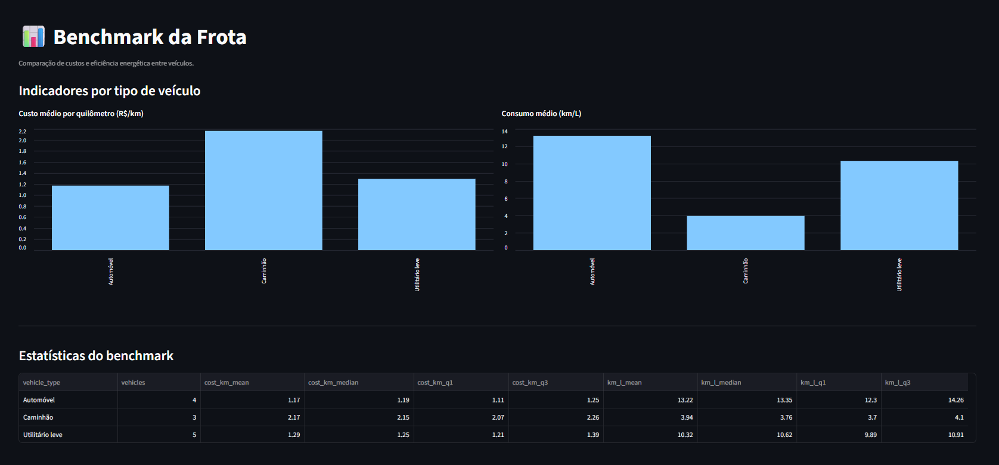

## 6.3. Monitoramento

Permite selecionar um veículo e visualizar os dados de telemetria, incluindo velocidade, RPM, nível de combustível e temperatura do motor.

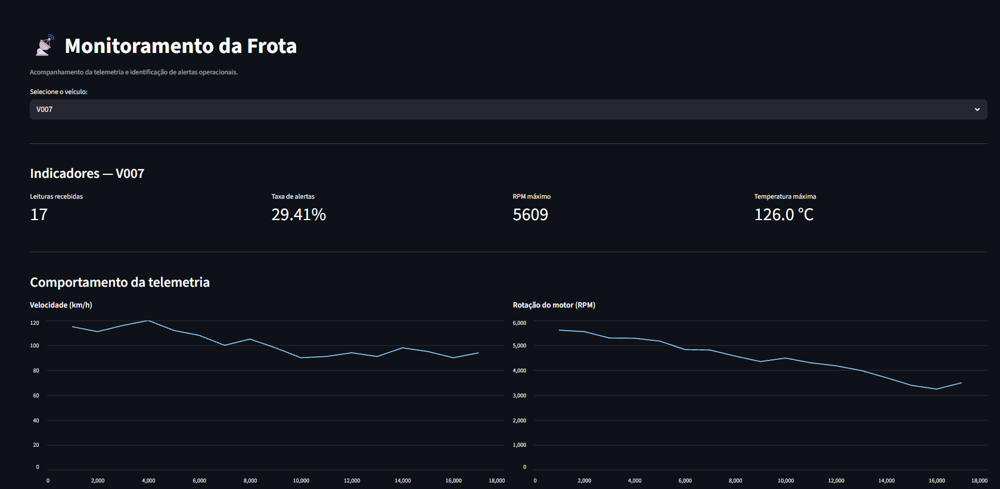

### Alertas e histórico

A tela também apresenta as leituras que geraram alertas e o histórico completo da simulação.

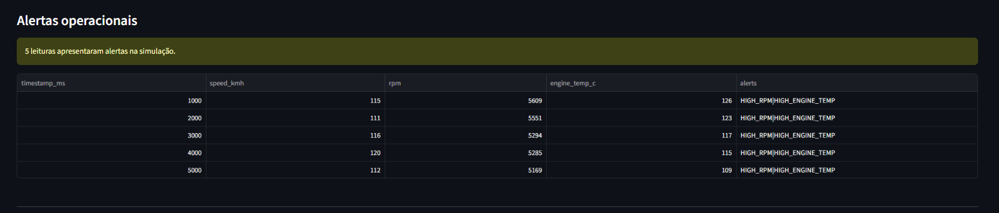

## 6.4. Validação da IA

Apresenta a distribuição das classes, métricas de avaliação, matriz de confusão e resultados das previsões do modelo.

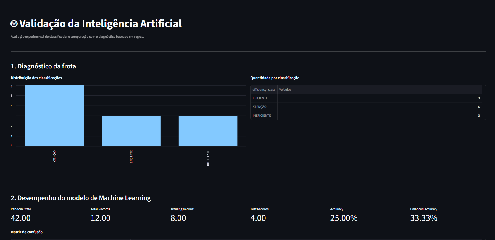

### Comparação entre regras e ML

A aplicação também apresenta a comparação entre as classificações produzidas pelo modelo e pelo diagnóstico baseado em regras.

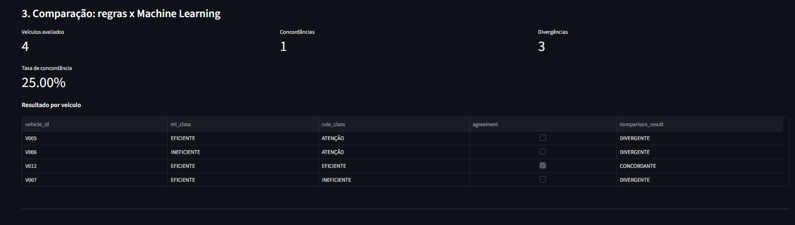

---

# 7. Tecnologias utilizadas

| Tecnologia | Aplicação |
|---|---|
| Python | Processamento e análise dos dados |
| Pandas | Manipulação e integração de dados |
| NumPy | Operações numéricas |
| Matplotlib | Geração de gráficos |
| Scikit-learn | Modelo de Machine Learning |
| Streamlit | Interface de visualização |
| ESP32 | Simulação de telemetria |
| Wokwi | Simulação do circuito e hardware |
| Git e GitHub | Versionamento e documentação |

---

# 8. Estrutura do projeto

```text
ENTERPRISE-CHALLENGE/
│
├── Sprint 1/
│
├── Sprint 2/
│   ├── app.py
│   ├── requirements.txt
│   ├── pages/
│   │   ├── 1_Benchmark.py
│   │   ├── 2_Monitoramento.py
│   │   └── 3_Validacao_IA.py
│   │
│   ├── data/
│   │   └── processed/
│   │
│   ├── reports/
│   │   └── figures/
│   │
│   ├── docs/
│   │   └── images/
│   │
│   ├── integrate_data.py
│   ├── process_telemetry.py
│   ├── telemetry_metrics.py
│   ├── diagnosis_rules.py
│   ├── fleet_benchmark.py
│   ├── efficiency_diagnosis.py
│   ├── efficiency_classifier.py
│   ├── compare_diagnosis_ml.py
│   └── visualize_results.py
│
└── README.md
```

---

# 9. Como executar

Clone o repositório:

```bash
git clone URL_DO_REPOSITORIO
```

Acesse a pasta da Sprint 2:

```bash
cd "ENTERPRISE-CHALLENGE/Sprint 2"
```

Instale as dependências:

```bash
pip install -r requirements.txt
```

Execute a aplicação:

```bash
streamlit run app.py
```

---

# 10. Próximas etapas

## Sprint 3 — Estimativa de economia e recomendações

- Estimar oportunidades de redução de custos.
- Calcular potenciais economias em reais.
- Criar recomendações de manutenção e operação.
- Relacionar os diagnósticos com oportunidades de melhoria.

## Sprint 4 — Integração, interface e finalização

- Consolidar os módulos desenvolvidos.
- Revisar a experiência de navegação.
- Validar os resultados.
- Finalizar documentação e evidências.
- Preparar a apresentação final.

---

# 11. Considerações finais

Ao final da Sprint 2, foi construído um protótipo funcional capaz de integrar dados, analisar indicadores da frota, monitorar telemetria simulada e produzir diagnósticos por regras e por um modelo experimental de Machine Learning.

A aplicação Streamlit reúne essas funcionalidades em uma interface única, facilitando a consulta e interpretação dos resultados.

As próximas etapas ampliarão a solução com estimativas de economia e recomendações para apoiar a tomada de decisão do gestor de frota.

---

## Entregas

- Vídeo de apresentação: https://youtu.be/-i4LeqD2mKE
