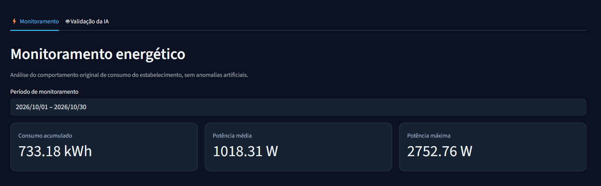

# ⚡ Smart Energy AI
### Sistema Inteligente de Monitoramento e Análise do Consumo de Energia Elétrica

Projeto desenvolvido para o **Global Solution 1 — FIAP**, com o objetivo de demonstrar como técnicas de Inteligência Artificial podem auxiliar no monitoramento do consumo de energia elétrica e na identificação de padrões anormais de utilização.

O sistema utiliza dados sintéticos de um medidor inteligente (*Smart Meter*), processamento com Python e um modelo de Machine Learning baseado em **Isolation Forest** para identificar possíveis anomalias no consumo.

---

## 📌 Visão geral

O Smart Energy AI simula o funcionamento de um sistema de monitoramento energético, processando dados de consumo e apresentando informações em um dashboard interativo.

O projeto possui duas funcionalidades principais:

- **Monitoramento:** visualização do consumo de energia, potência média, potência máxima e comportamento ao longo do período analisado.
- **Validação da IA:** identificação de possíveis anomalias e avaliação do desempenho do modelo de Machine Learning.

### Dashboard — Monitoramento



### Dashboard — Validação da IA


---

## 🎯 Objetivos

- Simular dados de consumo de energia elétrica em intervalos regulares.
- Processar e transformar os dados para análise.
- Identificar comportamentos que se desviam do padrão de consumo.
- Aplicar Machine Learning não supervisionado para detecção de anomalias.
- Disponibilizar os resultados em um dashboard interativo.

## 🏗️ Arquitetura do projeto

O fluxo de funcionamento é dividido em quatro etapas:

1. **Geração dos dados:** criação de registros simulados de um medidor inteligente.
2. **Processamento:** preparação dos dados e criação de atributos para análise.
3. **Detecção de anomalias:** treinamento e aplicação do algoritmo Isolation Forest.
4. **Visualização:** apresentação dos dados e resultados por meio do Streamlit.

```text
Dados simulados (CSV)
        |
        v
Python + Pandas + NumPy
        |
        v
Engenharia de atributos
        |
        v
Isolation Forest
        |
        v
Resultados da análise
        |
        v
Dashboard Streamlit
```

## 🛠️ Tecnologias utilizadas

| Tecnologia | Aplicação |
|---|---|
| Python | Linguagem principal |
| Pandas | Manipulação e processamento dos dados |
| NumPy | Operações matemáticas e atributos temporais |
| Scikit-learn | Pré-processamento e detecção de anomalias |
| Isolation Forest | Algoritmo de Machine Learning |
| Streamlit | Desenvolvimento do dashboard |
| Plotly | Visualização dos dados |

## 📂 Estrutura do repositório

```text
GLOBAL-SOLUTION-1/
│
├── dashboard/
│   └── app.py
│
├── data/
│   ├── raw/
│   │   └── smart_meter_data.csv
│   │
│   └── processed/
│       ├── smart_meter_validation.csv
│       └── anomaly_detection_results.csv
│
├── docs/
│   └── images/
│
├── src/
│   ├── data_generator.py
│   ├── data_processing.py
│   └── anomaly_detection.py
│
├── README.md
└── requirements.txt
```

## 📊 Dados utilizados

O projeto utiliza dados sintéticos para representar o funcionamento de um medidor inteligente instalado em um pequeno estabelecimento comercial.

As informações são geradas em intervalos de 15 minutos, durante um período de 30 dias.

**Características da base de dados:**

- Dispositivo simulado: `SM001`
- Período: 30 dias
- Intervalo de leitura: 15 minutos
- Total: 2.880 registros
- Anomalias artificiais inseridas para validação: 20

Entre as variáveis utilizadas estão:

- `timestamp`: data e horário da leitura.
- `device_id`: identificação do dispositivo.
- `voltage_v`: tensão elétrica.
- `current_a`: corrente elétrica.
- `power_w`: potência elétrica.
- `power_factor`: fator de potência.
- `energy_kwh_interval`: consumo de energia no intervalo.

O consumo energético de cada intervalo é calculado considerando a potência média registrada durante 15 minutos:

```python
energy_kwh_interval = (power_w * 0.25) / 1000
```

As bases de dados possuem finalidades diferentes: a base original representa o comportamento normal simulado, enquanto a base de validação contém anomalias artificiais identificadas para avaliação do modelo.

## 🤖 Detecção de anomalias com Machine Learning

O algoritmo escolhido foi o **Isolation Forest**, disponível na biblioteca Scikit-learn.

O modelo é treinado com os dados originais e utiliza características relacionadas ao comportamento do consumo, como:

- Potência e corrente elétrica.
- Fator de potência.
- Horário do registro.
- Indicador de final de semana.
- Média e desvio padrão móvel da potência.
- Desvio em relação ao perfil esperado de consumo.

A representação cíclica do horário permite que o modelo considere a continuidade entre o final e o início do dia:

```python
df["hour_sin"] = np.sin(
    2 * np.pi * df["hour"] / 24
)

df["hour_cos"] = np.cos(
    2 * np.pi * df["hour"] / 24
)
```

O modelo utiliza um pipeline com padronização dos atributos e Isolation Forest:

```python
model = Pipeline([
    ("scaler", StandardScaler()),
    ("isolation_forest", IsolationForest(
        n_estimators=200,
        contamination=20/2880,
        random_state=42
    ))
])
```

O algoritmo classifica os registros como normais ou anômalos de acordo com seu comportamento em relação ao padrão aprendido.

## 📈 Resultados da validação

Na execução utilizada para esta documentação, o modelo apresentou os seguintes resultados:

| Métrica | Resultado |
|---|---:|
| Precisão | 23,53% |
| Recall | 40,00% |
| F1-score | 29,63% |
| Anomalias artificiais inseridas | 20 |
| Anomalias artificiais identificadas | 8 |

A avaliação por tipo de anomalia apresentou:

| Tipo de anomalia | Inseridas | Identificadas |
|---|---:|---:|
| Consumo noturno | 10 | 2 |
| Pico de potência | 10 | 6 |
| **Total** | **20** | **8** |

Os resultados indicam que o modelo conseguiu identificar parte dos comportamentos artificiais inseridos na base de validação, mas também apresentou falsos positivos e deixou de detectar algumas anomalias.

Esses resultados são experimentais e não representam uma garantia de desempenho em instalações reais.

## ▶️ Como executar o projeto

### 1. Pré-requisitos

- Python 3.10 ou superior.
- Git.
- Ambiente virtual Python recomendado.

### 2. Clonar o repositório

```bash
git clone URL_DO_REPOSITORIO
```

Entre na pasta do projeto:

```bash
cd GLOBAL-SOLUTION-1
```

### 3. Criar e ativar o ambiente virtual

No Windows:

```bash
python -m venv venv
venv\Scripts\activate
```

### 4. Instalar as dependências

```bash
pip install -r requirements.txt
```

### 5. Executar os scripts

Execute os scripts na seguinte ordem:

```bash
python src/data_generator.py
```

```bash
python src/data_processing.py
```

```bash
python src/anomaly_detection.py
```

Essa sequência gera os dados, realiza o processamento e executa a detecção de anomalias.

### 6. Iniciar o dashboard

```bash
streamlit run dashboard/app.py
```

O Streamlit disponibilizará o dashboard no navegador.

## 🌱 Objetivos de Desenvolvimento Sustentável

O projeto possui relação com os seguintes Objetivos de Desenvolvimento Sustentável da ONU:

- **ODS 7 — Energia Limpa e Acessível:** incentivo ao acompanhamento do consumo e à identificação de possíveis desperdícios.
- **ODS 12 — Consumo e Produção Responsáveis:** utilização de dados para apoiar decisões mais conscientes sobre o consumo de energia.

A proposta é contribuir para uma gestão energética mais eficiente por meio de monitoramento e análise inteligente de dados.

## ⚠️ Limitações e trabalhos futuros

O projeto utiliza dados sintéticos e anomalias inseridas artificialmente. Portanto, sua validação ainda está restrita a um cenário experimental.

Como possibilidades de evolução, destacam-se:

- Integração com medidores inteligentes reais.
- Coleta contínua de dados por MQTT.
- Ampliação dos padrões de anomalia analisados.
- Aprimoramento dos atributos e parâmetros do modelo.
- Avaliação com dados reais de diferentes perfis de consumo.

## 🎥 Demonstração

**Vídeo de apresentação:** youtu.be/tYRKxMYu4NI

## 📄 Documentação

**Documentação técnica e acadêmica:** github.com/pl-gonzalez/FIAP-PORTFOLIO-AI/blob/master/1TIAO/GLOBAL-SOLUTION-1/docs/PabloGonzalez_rm567944.pdf

## 👥 Autoria

Projeto desenvolvido como parte do Global Solution 1 do curso de Tecnologia em Inteligência Artificial da FIAP.

**Integrantes:** Pablo Leon Dimauro Gonzalez (RM 567944)

**Turma:** 1TIAOR

---

*Smart Energy AI — Da análise de dados à identificação inteligente de padrões de consumo energético.*